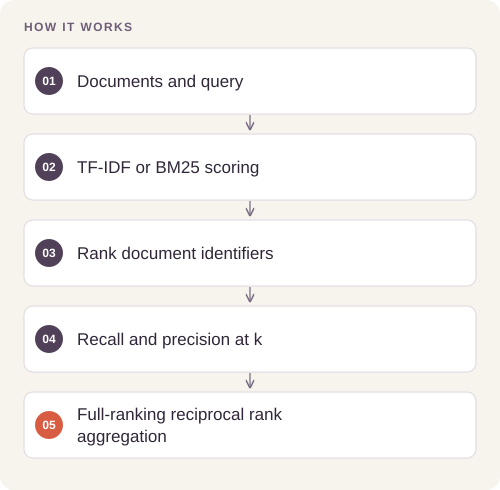

# Semantic Retrieval Benchmark

Compare lexical, static-embedding, and transformer retrieval to quantify the accuracy and indexing-cost trade-off for question answering.

## Implementation

A standalone BM25 implementation, an optional Sentence Transformers index, and macro retrieval metrics.




## Reproduce corpus retrieval

A full-corpus benchmark entry point now retains rankings and evaluates supplied judgments. A new fixed BEIR SciFact test run uses5,183 documents and300 queries, with corpus provenance and full-ranking MRR.

[Commands, artifacts and benchmark scope](BENCHMARKS.md) · [Versioned profiles](reproduction.json)


## Try a small example

A tiny local corpus exercises lexical ranking and metrics. Reciprocal rank uses the full ranking; this is not a benchmark of pretrained embedding quality.

After the local setup below, run from the repository root:

```sh
python examples/quickstart.py
```

The [example source](examples/quickstart.py), [captured output](examples/expected-output.txt) and [execution record](examples/environment.json) keep this demonstration inspectable. Floating-point values may vary with library versions.

Observed output from this run:

```text
{
  "ranked_indices": [
    0
  ],
  "top_document": "walrus tusks",
  "metrics": {
    "recall": 1.0,
    "precision": 1.0,
    "mrr": 1.0
  }
}
```

## Completed study

On the saved 1,600-query test partition, MPNet reports Recall@5 of 0.9606 and MRR of 0.9296, compared with MiniLM MRR 0.8979 and BGE-small MRR 0.9058. MPNet indexing takes 767.8 seconds in the recorded environment versus 110.9 seconds for MiniLM.

These historical figures describe the completed study. This refactored standalone implementation has separate validation and has not been used to recertify the historical benchmark. The public release contains the portable core and focused tests.

## Run locally

Python 3.11 or later.

```sh
python -m venv .venv
source .venv/bin/activate
python -m pip install -r requirements.txt
python smoke_test.py
python retrieval.py /path/to/documents.json "your question"
```

Prepare your own inputs as described in [DATA.md](DATA.md). Tests use generated fixtures and do not need credentials or provider calls. [VALIDATION.md](VALIDATION.md) records their scope.

For optional dense retrieval, install `sentence-transformers` separately and pass an authorized model identifier to `SemanticIndex`. That dependency and model are not needed for the included lexical checks.

## Practical relevance and limitations

The experiment uses a reduced Natural Questions corpus containing judged documents and 1,000 distractors, with 400 validation queries. These scores are not full-corpus BEIR leaderboard results; timings depend on hardware and cache state.

## Reuse

The original contributions listed in [LICENSING.md](LICENSING.md) are available under [MIT](LICENSE). This scoped grant preserves upstream notices and separate dataset, simulator, notebook and checkpoint terms.
